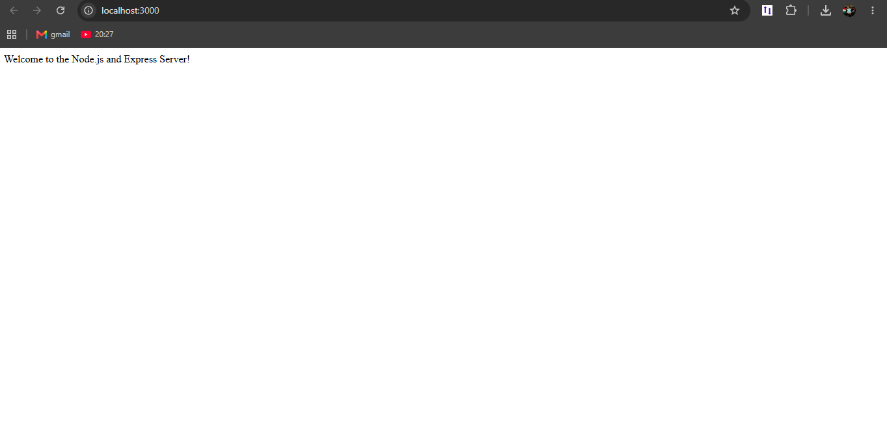
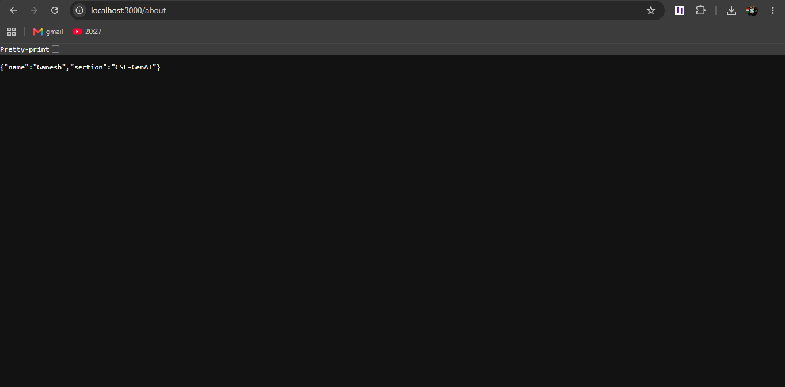
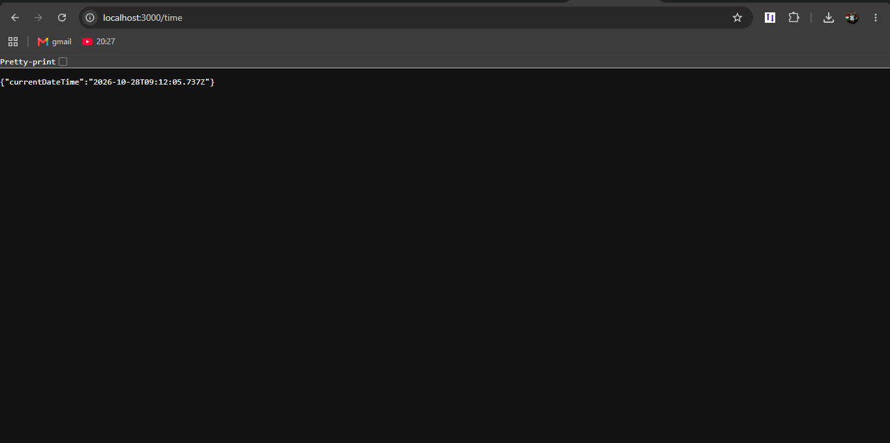
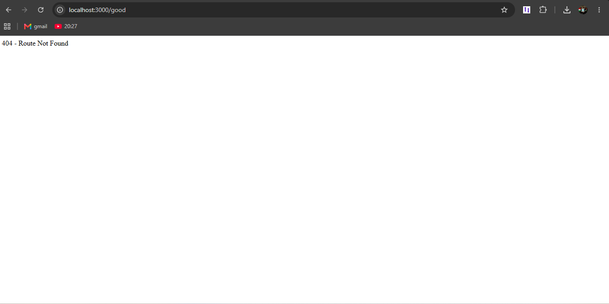

# Lab 1: Node.js and Express Server

**Name:** Ganesh  
**Registration Number:** 9041  
**Section:** CSE-GenAI

## 1. Live Link

**Deployment Status:** Not deployed yet.

Add your public deployment URL here after successfully deploying the project.

## 2. Objective

To create a basic HTTP server using Node.js and an Express server with multiple routes, JSON responses, the current date and time, and a custom 404 Not Found handler.

## 3. Requirements

- Node.js
- npm (Node Package Manager)
- A web browser
- Git and a GitHub account

## 4. Project Structure

```text
lab-01/
├── server.js
├── basic-server.js
├── package.json
├── package-lock.json
├── README.md
└── screenshots/
    ├── home.png
    ├── about.png
    ├── time.png
    └── not-found.png
```

**Note:** The screenshot files must be created by running and testing the application. The `node_modules/` folder should not be committed to GitHub.

## 5. Installation and Execution

### Step 1: Open the project folder

Open the terminal in the `lab-01` folder.

### Step 2: Install dependencies

```bash
npm install
```

This command installs the packages required by the project.

### Step 3: Start the Express server

```bash
npm start
```

Open the following URL in your browser:

http://localhost:3000

### Step 4: Run the basic Node.js HTTP server

Stop the Express server first by pressing `Ctrl + C` in the terminal. Then run:

```bash
npm run start:basic
```

Both servers use port 3000 by default. Run only one at a time unless you configure different ports.

## 6. Endpoints and Their Functions

| Method | Path | Description | Expected Status |
|---|---|---|---|
| GET | `/` | Returns a welcome message | 200 OK |
| GET | `/about` | Returns name and section as JSON | 200 OK |
| GET | `/time` | Returns the current date and time as JSON | 200 OK |
| GET | `/unknown` | Demonstrates an unmatched route | 404 Not Found |

### Endpoint URLs

- Home: http://localhost:3000/
- About: http://localhost:3000/about
- Time: http://localhost:3000/time
- 404 Example: http://localhost:3000/unknown

## 7. Screenshots

Save your screenshots in the `screenshots/` folder. The images will appear directly in this README when the files are committed to GitHub.

### 7.1 Home Page



### 7.2 About Page



### 7.3 Current Date and Time



### 7.4 404 Not Found Page



**Important:** These image links require the corresponding PNG files to exist in the `screenshots/` folder. Replace them with your actual screenshots; do not submit empty or missing screenshot files.

## 8. HTTP Status Codes

**200 OK:** The request was successful. The home, about, and time routes should return this status.

**404 Not Found:** The requested URL does not match any defined route. The server returns this status for an unknown path.

## 9. Problems Encountered and Solutions

Record the actual issues encountered while completing the lab. Examples you can use if they apply to your experience:

- **Problem:** Dependencies were missing.  
  **Solution:** Ran `npm install` to install the required packages.

- **Problem:** The server port was already in use.  
  **Solution:** Stopped the other server using `Ctrl + C` before starting another server on port 3000.

- **Problem:** Screenshots were not visible in the GitHub README.  
  **Solution:** Used relative Markdown image paths and uploaded the screenshot files to the `screenshots/` folder.

## 10. GitHub Submission

Initialize Git if necessary, then run these commands from the project folder:

```bash
git init
git add .
git commit -m "Complete Lab 1 Node.js and Express server"
git branch -M main
git remote add origin YOUR_GITHUB_REPOSITORY_URL
git push -u origin main
```

Replace `YOUR_GITHUB_REPOSITORY_URL` with your actual GitHub repository URL. If a remote is already configured, do not add it again.

Create a `.gitignore` file containing:

```gitignore
node_modules/
.env
```

Check that the screenshots are included in the commit and that `node_modules/` and `.env` are excluded.

## 11. Conclusion

In this lab, I created and tested a basic HTTP server using Node.js and Express. I learned how to define routes, return JSON responses, display the current date and time, handle unknown routes with a 404 status code, and document the project using a GitHub README with screenshots.
