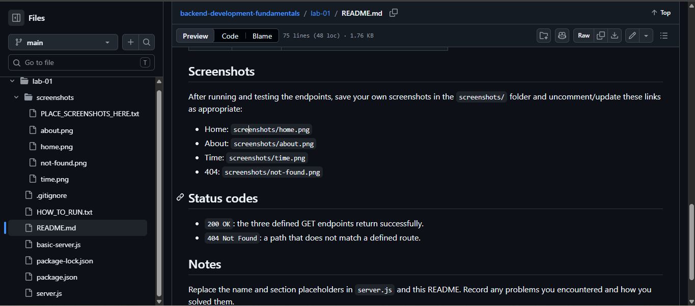
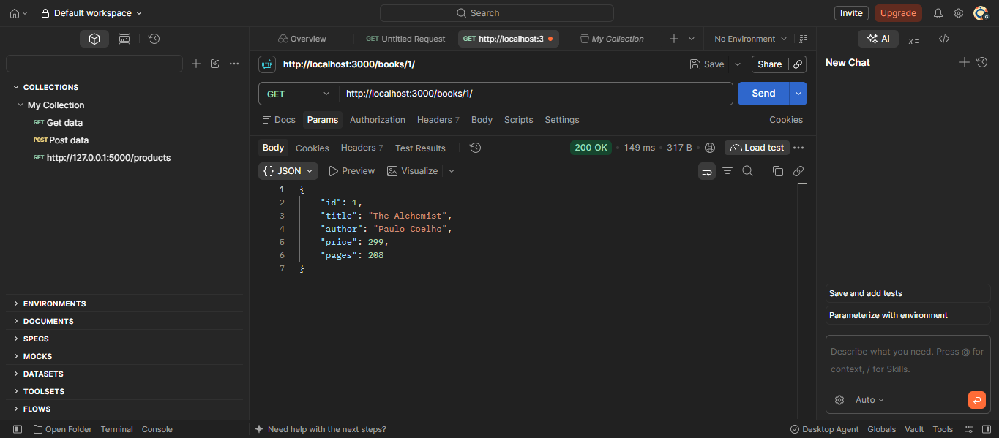
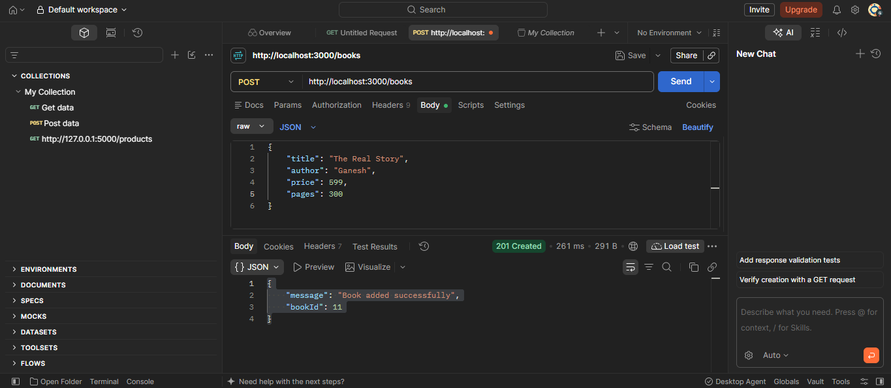
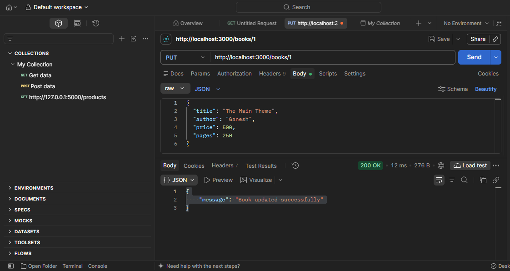
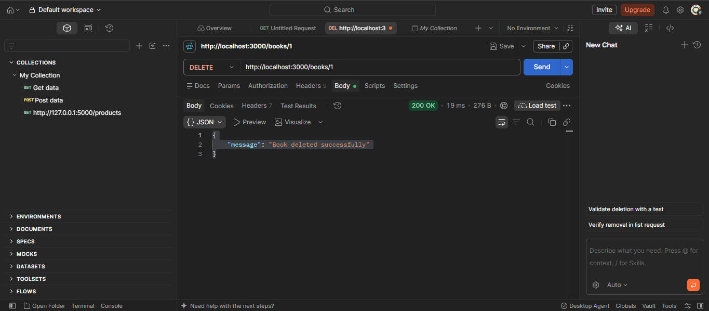
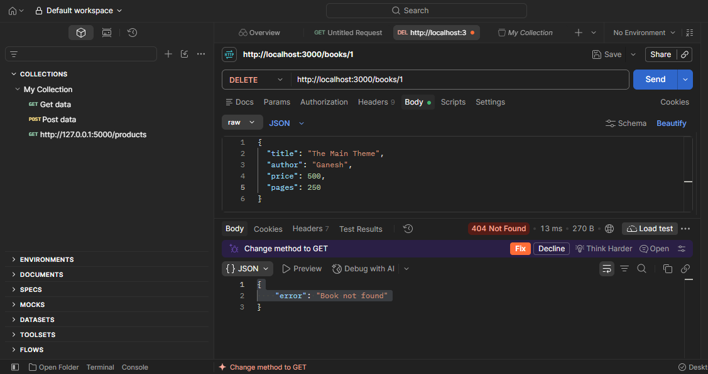
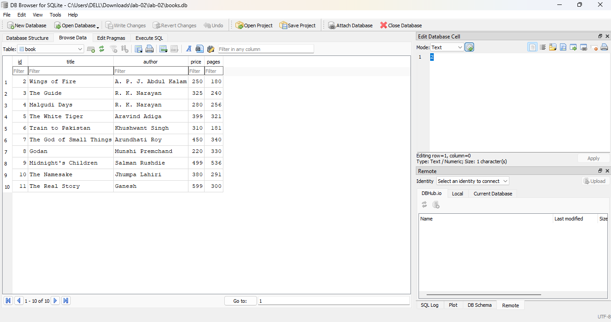

# Lab 2: SQLite database and CRUD routes

**Name:** G. Ganesh · **Registration number:** 9041 · **Section:** CSE-GenAI-2A

**Live link:** PASTE YOUR DEPLOYED URL HERE (or explain why the project could not be deployed)

## How to run

```bash
# 1. install dependencies
npm install

# 2. (first time only) create the database and insert 10 rows
sqlite3 books.db < schema.sql

# 3. start the server with auto-restart (nodemon)
npm run dev
# or without nodemon
npm start
```

**Environment variables:** `PORT` (optional, default `3000`). No secrets are needed. If you add a `.env` file, it is git-ignored and must never be committed.

The server opens `books.db` first and starts listening only after the connection succeeds (`initializeDBAndServer()`).

## Table

`book(id INTEGER PRIMARY KEY, title TEXT, author TEXT, price INTEGER, pages INTEGER)`

## Endpoints

| Method | Path | Description | Success / error codes |
| --- | --- | --- | --- |
| GET | `/books/` | Return all books | 200 |
| GET | `/books/:bookId/` | Return one book | 200, 400 (bad id), 404 |
| POST | `/books/` | Add a new book (JSON body: title, author, price, pages) | 201, 400 |
| PUT | `/books/:bookId/` | Update every field of an existing book | 200, 400, 404 |
| DELETE | `/books/:bookId/` | Delete a book | 200, 400, 404 |

All queries that take user input use `?` placeholders (parameterised queries).

## Screenshots









## Notes: problems faced and how I solved them

- Write your own notes here.
