# Lab 3: REST API, query parameters, validation, debugging

Name: GOLLA GANESH
Registration number: 252U1R9041
Section: CSE-GenAI-2A-304
Live link: https://backend-development-fundamentals-3-9iza.onrender.com/books

## Install and run
Requires Node.js 18 or newer.

```bash
npm install
npm start
```
Server: `http://localhost:3000`
Optional environment variables: `PORT` and `DB_PATH`. On first startup, the API adds 15 sample books only if the selected database is empty; it does not clear existing records.

Run the API tests with:
```bash
npm test
```

## Endpoints

| Method | Path | Description |
|---|---|---|
| GET | `/books` | List books with search, sorting, filters and pagination |
| GET | `/books/:id` | Get one book |
| POST | `/books` | Create a book |
| PUT | `/books/:id` | Update a book |
| DELETE | `/books/:id` | Delete a book |

## GET query parameters
Example:
`/books?search_q=alch&order_by=price&order=DESC&limit=5&offset=0&min_price=100&max_price=500`

- `search_q`: partial title search
- `order_by`: `id`, `title`, `author`, `price`, or `pages`
- `order`: `ASC` or `DESC`
- `limit`: positive integer; default 10
- `offset`: non-negative integer; default 0
- `min_price`, `max_price`: optional non-negative price range

## POST/PUT JSON body
```json
{
  "title": "The Alchemist",
  "author": "Paulo Coelho",
  "price": 350,
  "pages": 208
}
```
Title and author must be non-empty strings. Price must be a non-negative number. Pages is optional and must be a positive integer when provided; it defaults to `1`.

## Status codes
- 200: successful GET, update or delete
- 201: created
- 400: invalid input
- 404: record or route not found
- 413: request body is too large
- 500: server/database error

## Postman test checklist
1. GET `/books` — expect 200.
2. POST `/books` with valid JSON — expect 201.
3. GET `/books?search_q=alch` — test partial title search.
4. GET `/books?order_by=price&order=DESC` — test sorting.
5. GET `/books?min_price=100&max_price=500` — test price range.
6. GET `/books?limit=2&offset=0` — test pagination.
7. POST `/books` without title — expect 400.
8. POST `/books` with non-numeric price — expect 400.
9. GET `/books/999999` — expect 404 if absent.
10. GET `/books/1` — expect 200 if present.
11. PUT `/books/1` with valid JSON — expect 200.
12. DELETE `/books/1` — expect 200.
13. DELETE `/books/999999` — expect 404 if absent.

## Debugging
- `EADDRINUSE`: stop the process already using the port or change `PORT`.
- Wrong import path: check filename and relative path.
- `no such table`: verify database path and table creation.
- Missing `await`: await database calls before using results.

## Screenshots

Postman/Thunder Client captures for the checklist are included below. The original image files are in the `screenshots/` folder.

1. **GET `/books` — expect 200**

   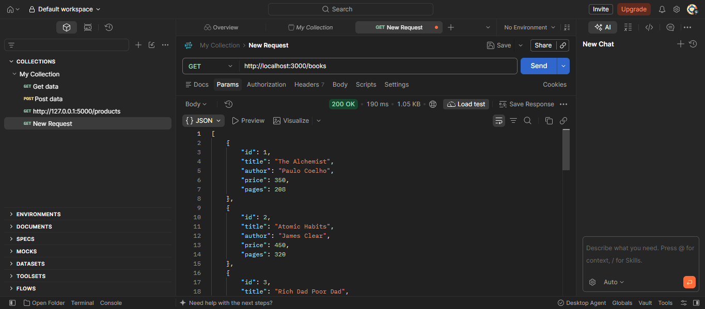

2. **POST `/books` with valid JSON — expect 201**

   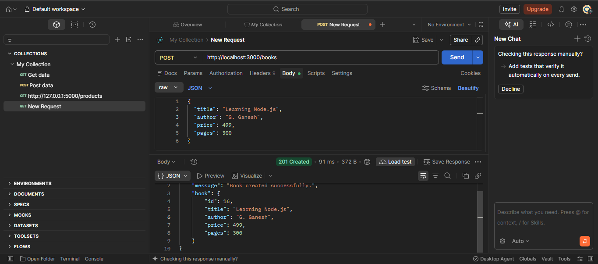

3. **GET `/books?search_q=alch` — partial title search**

   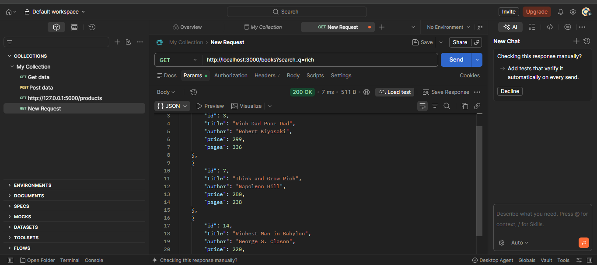

4. **GET `/books?order_by=price&order=DESC` — sorting**

   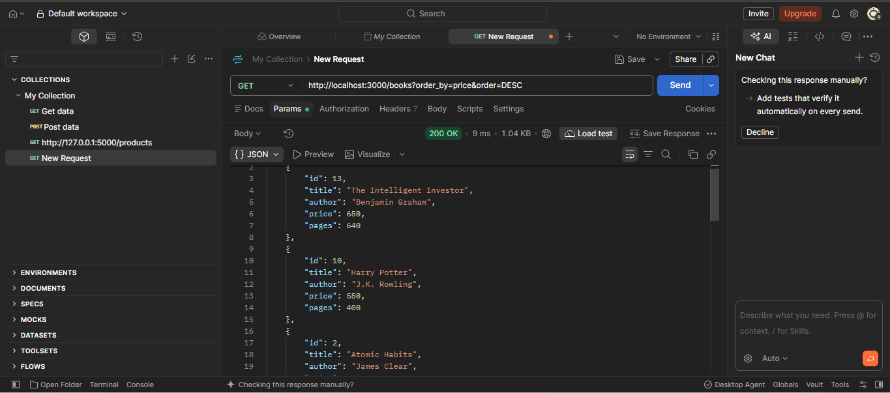

5. **GET `/books?min_price=100&max_price=500` — price range**

   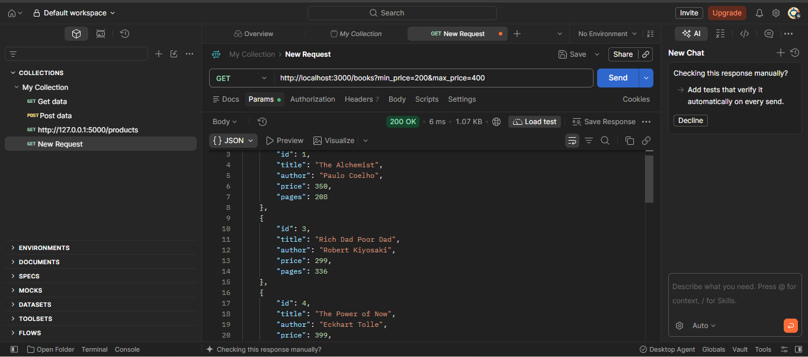

6. **GET `/books?limit=2&offset=0` — pagination**

   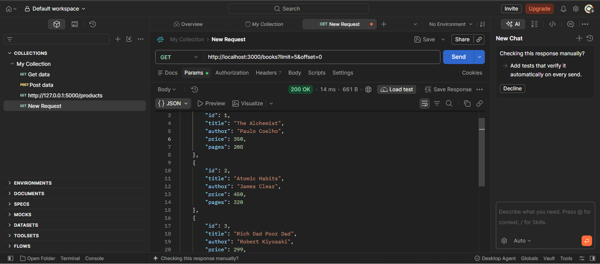

7. **POST `/books` without title — expect 400**

   

8. **POST `/books` with non-numeric price — expect 400**

   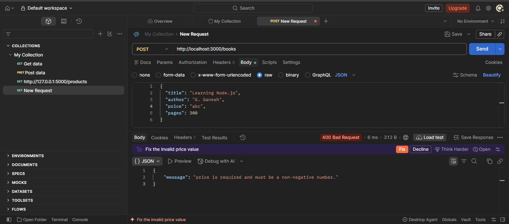

9. **GET `/books/999999` — expect 404 if absent**

   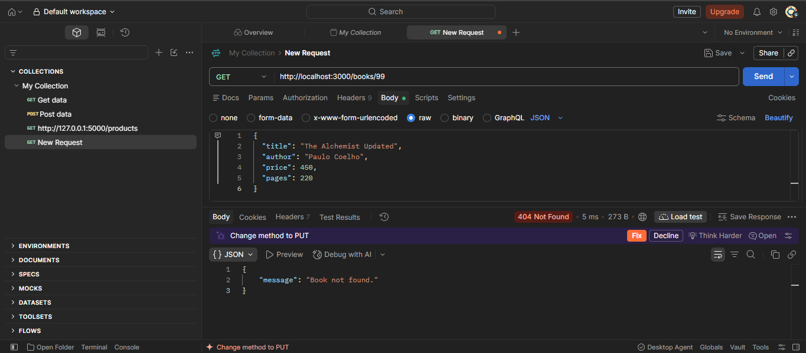

10. **GET `/books/1` — expect 200 if present**

    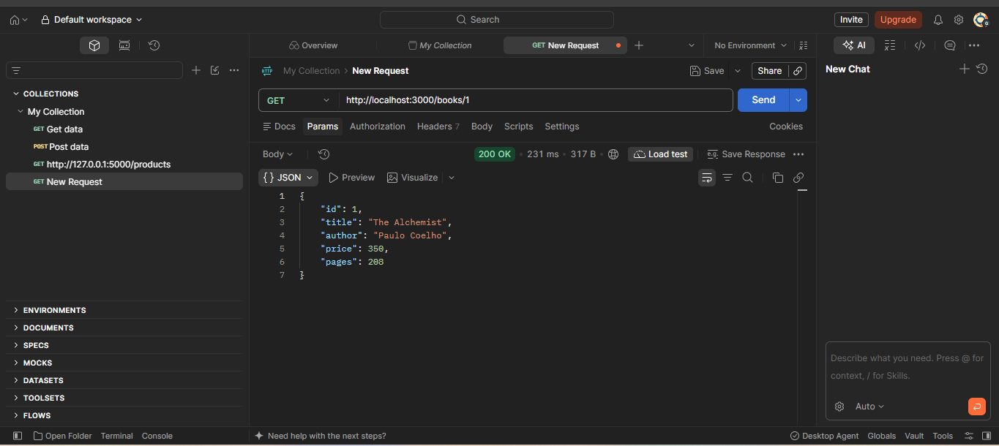

11. **PUT `/books/1` with valid JSON — expect 200**

    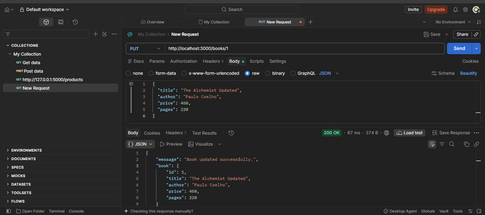

12. **DELETE `/books/1` — expect 200**

    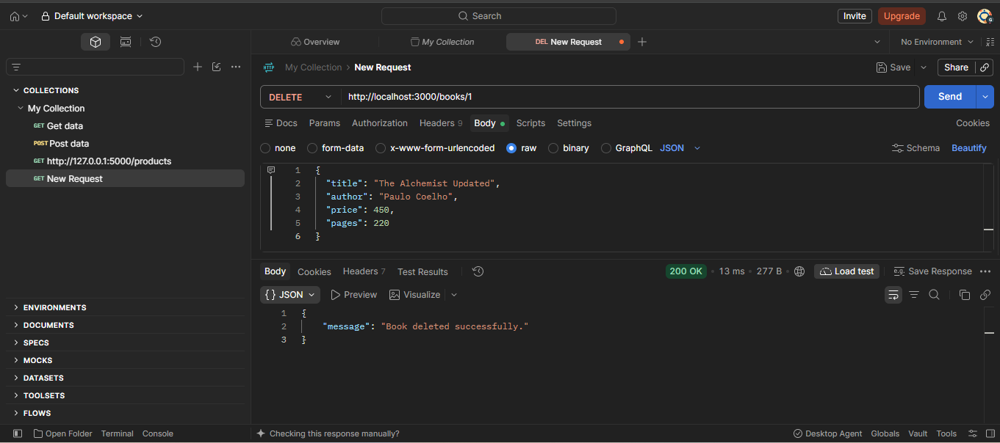

13. **DELETE `/books/999999` — expect 404 if absent**

    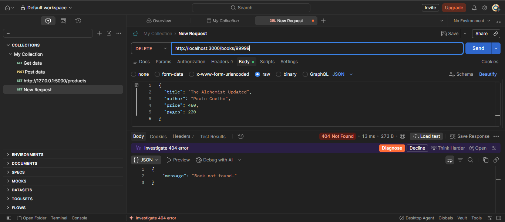

Do not commit `node_modules`, `.env`, or local database files. Replace student placeholders and add your own screenshots before submission.
